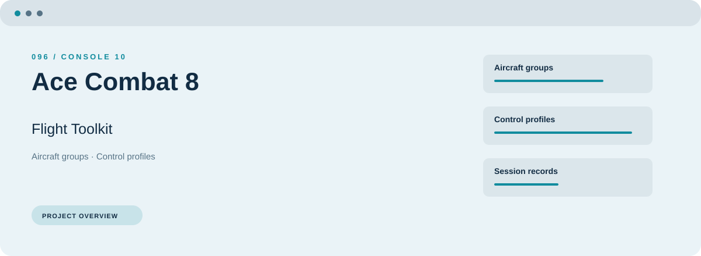
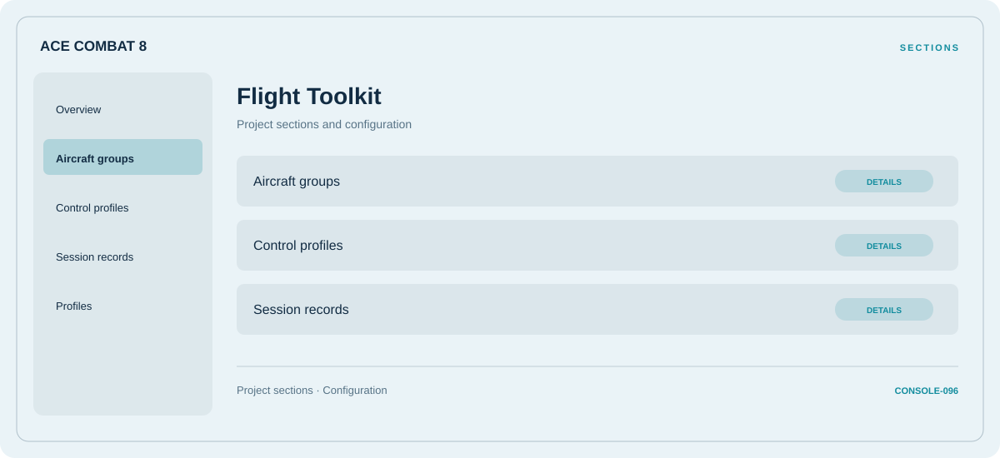

# 🛠️ Ace Combat 8 Flight Toolkit

**Aircraft groups · Control profiles · Session records**

## ⚡ Features

Start with aircraft groups, organize control profiles, and keep session records close at hand. These are the main areas covered by Ace Combat 8 Flight Toolkit.

### ⚙️ Aircraft groups

A dedicated section for aircraft groups and the configuration details associated with that area.

### 🧩 Control profiles

Related settings collected into named groups for a clearer configuration workflow.

### ⌨️ Session records

Session and activity information grouped by the task or context it belongs to.

## 🖥️ Project navigation

## 📥 Download

The button and cover open the project's download page. Use the information supplied with the downloaded package for installation and release-specific requirements.

## 📚 Project documentation

- [Feature reference](docs/FEATURES.md)
- [Download information](docs/DOWNLOAD.md)
- [Project page](index.html)

---

Ace Combat 8 Flight Toolkit · Program documentation and download information.
